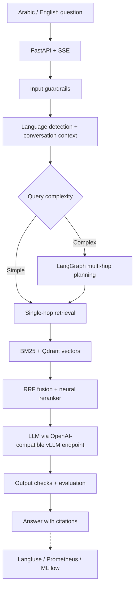

<div align="center">

# Muḥāwir | محاور
### Bilingual agentic knowledge assistant

**Arabic + English · LangGraph · Hybrid RAG · Evaluations · Guardrails**

[](https://github.com/FaizanAKhan786/muhawir/actions/workflows/ci.yml)


[Quick start](#quick-start) · [Architecture](#architecture) · [Evaluation](#evaluation-and-tests) · [Source](https://github.com/FaizanAKhan786/muhawir)

</div>

## At a glance

Muḥāwir is an **Arabic/English agentic knowledge assistant** built around retrievers, rerankers, contextual conversation, and measurable answer quality. It is a source-code project for experimenting with production-oriented AI architecture, not a claim of a hosted commercial service.

| Capability | Implementation |
| --- | --- |
| Agent workflows | LangGraph, simple and multi-hop query paths |
| Knowledge retrieval | BM25 + Qdrant vector search with reciprocal-rank fusion |
| Answer quality | Neural reranking, citations, evaluation and retry logic |
| Multilingual processing | Arabic normalization, bilingual language handling |
| Memory and caching | Redis-backed session utilities and semantic cache |
| Serving and visibility | FastAPI, server-sent events, metrics and tracing integration |

## Architecture



The diagram summarizes the intended request path. Some services depend on separately deployed model infrastructure and configured credentials.

## Quick start

**Requirements:** Python 3.11+, Docker and Docker Compose for infrastructure, and an OpenAI-compatible model server for generation.

```bash
git clone https://github.com/FaizanAKhan786/muhawir.git
cd muhawir
python -m venv .venv
source .venv/bin/activate   # Windows: .venv\Scripts\activate
pip install -e ".[dev]"
cp .env.example .env
```

Configure `.env` for your vLLM endpoint (`VLLM_BASE_URL` defaults to port 8001), Qdrant, Redis, and optional tracing credentials. Then start the dependencies and API:

```bash
docker compose up -d qdrant redis postgres langfuse
uvicorn src.api.main:app --reload --port 8000
```

Open [API docs](http://localhost:8000/docs) locally. Initial model downloads and inference capacity depend on your machine. **A working Qdrant container is not a substitute for a running LLM endpoint.**

For corpus preparation, see [the ingestion script](scripts/ingest_corpus.py) and [sample documents](data/sample_docs/). The `Makefile` provides shortcuts such as `make ingest`, `make docker-up`, and `make eval`.

## Evaluation and tests

```bash
pytest tests/ -v
ruff check .
python scripts/run_eval.py --golden-set data/golden_sets/golden_v1.0.json
```

Evaluation code lives in [`src/evaluation/`](src/evaluation/) and sample benchmark data in [`data/golden_sets/`](data/golden_sets/). Thresholds in configuration are **quality gates**, not measured accuracy claims. Confirm model and dataset availability before running a full evaluation.

## Repository map

| Path | What it contains |
| --- | --- |
| [`src/agents/`](src/agents/) | LangGraph orchestration and agent logic |
| [`src/retrieval/`](src/retrieval/) | Sparse/dense search, reranking, cache |
| [`src/guardrails/`](src/guardrails/) | Input and output protection |
| [`src/memory/`](src/memory/) | Conversation memory |
| [`src/mcp_servers/`](src/mcp_servers/) | MCP tools |
| [`monitoring/`](monitoring/) | Operational integrations |

## Scope and limitations

This repo showcases an **engineering implementation and reference architecture**. Running all paths requires appropriate inference compute, model assets, external service configuration and evaluation data. No real government data or proprietary deployment is included.

[Issues](https://github.com/FaizanAKhan786/muhawir/issues) · [GitHub profile](https://github.com/FaizanAKhan786)
